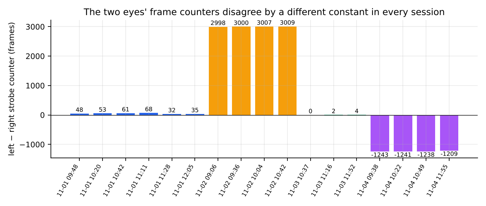
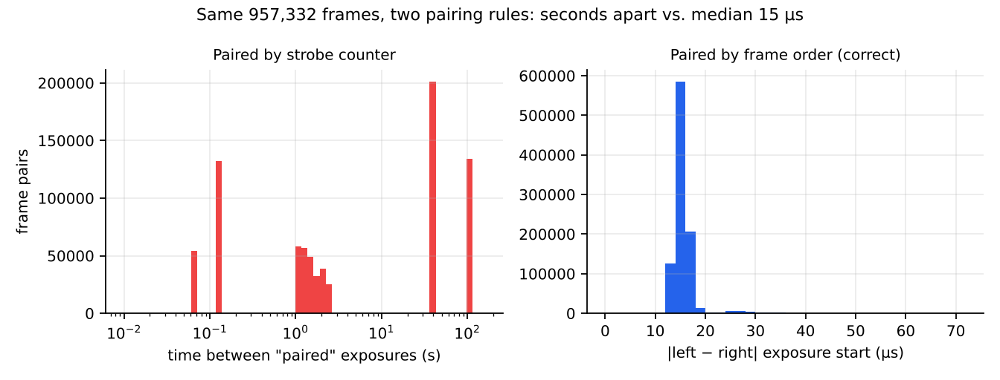
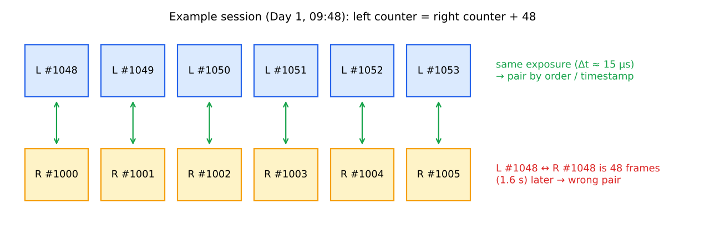
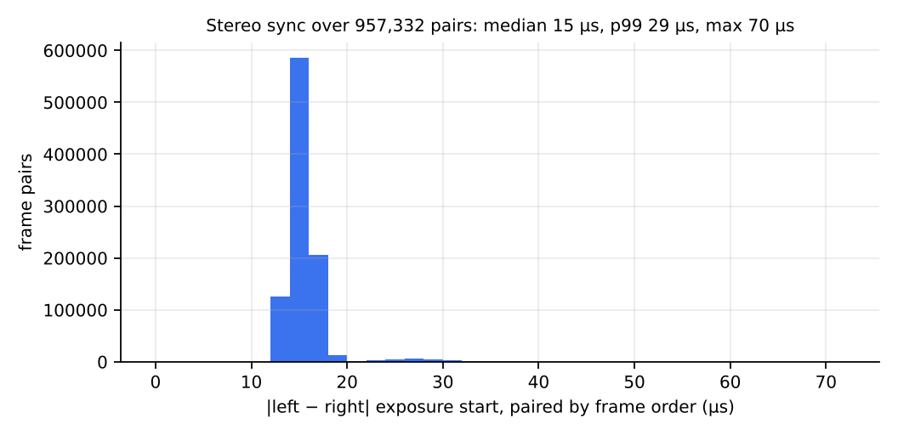

<!-- ODL_QUALITY_V2 -->

# Origin Data Lab · Technical Field Note #18

**ODL Stereo Frame Pairing Counter Offset**

[](https://github.com/origin-data-lab/stereo-frame-pairing-strobe-counter-offset) [](https://huggingface.co/datasets/origin-data-lab/stereo-frame-pairing-strobe-counter-offset) [](https://www.kaggle.com/datasets/origindatalab/odl-stereo-frame-pairing-counter-offset) [](https://origindatalab.io/technical-field-notes/stereo-frame-pairing-strobe-counter-offset.html)

[English technical note](https://origindatalab.io/technical-field-notes/stereo-frame-pairing-strobe-counter-offset.html) | [Korean technical note](https://origindatalab.io/ko/technical-field-notes/stereo-frame-pairing-strobe-counter-offset.html)

---

# ODL Field Note #18 — Don't pair stereo frames by their counters: per-session offsets of up to 3,009 frames, true sync 15 µs

957,332 left/right frame pairs over four days of real work: the two eyes' strobe counters differ by a constant that changes every session (−1,243 to +3,009 frames). Pairing by counter puts 'pairs' up to 100 s apart; pairing by frame order gives a 15 µs median and 70 µs maximum exposure-start difference.

```bash
pip install numpy opencv-python-headless pyyaml imageio-ffmpeg matplotlib
python3 analysis/odl_analyze.py --root <raw_dir> --out out   # per-frame SEI timing, IMU, image samples
python3 analysis/figs.py                                      # tables and figures for this note
```
Raw recordings are not distributed (people at work). Tables in `assets/tables/` are the derived data behind every number in the note.

Website: https://origindatalab.io/technical-field-notes/stereo-frame-pairing-strobe-counter-offset.html

Licence: Creative Commons Attribution 4.0 International (CC BY 4.0) for derived data and figures; MIT for code.

## Visual evidence

Figures are taken from the released technical-note package. Interpret with the original methods and limitations.

### Figure 1



*Left − right strobe counter for each work session, coloured by day.*

### Figure 2



*The same 957,332 frames under the two pairing rules. Pairs that the counter rule gets right (offset 0) fall below the left panel's range.*

### Figure 3



*The same exposures carry different counter values in the two eyes. In this session the left counter is always the right counter plus 48.*

### Figure 4



*Exposure-start difference of every order-based pair: the rig's true stereo synchronisation.*


---

## Explore Origin Data Lab

[](https://github.com/origin-data-lab/stereo-frame-pairing-strobe-counter-offset) [](https://huggingface.co/datasets/origin-data-lab/stereo-frame-pairing-strobe-counter-offset) [](https://www.kaggle.com/datasets/origindatalab/odl-stereo-frame-pairing-counter-offset) [](https://origindatalab.io/technical-field-notes/stereo-frame-pairing-strobe-counter-offset.html)

[Official Website](https://origindatalab.io/) | [Technical Field Notes](https://origindatalab.io/technical-field-notes/) | [English Note](https://origindatalab.io/technical-field-notes/stereo-frame-pairing-strobe-counter-offset.html) | [Korean Note](https://origindatalab.io/ko/technical-field-notes/stereo-frame-pairing-strobe-counter-offset.html)

[GitHub](https://github.com/origin-data-lab/stereo-frame-pairing-strobe-counter-offset) | [Hugging Face](https://huggingface.co/datasets/origin-data-lab/stereo-frame-pairing-strobe-counter-offset) | [Kaggle Dataset](https://www.kaggle.com/datasets/origindatalab/odl-stereo-frame-pairing-counter-offset) | [Kaggle Notebook](https://www.kaggle.com/code/origindatalab/odl-stereo-frame-pairing-counter-offset-notebook)


## Code availability

Device-specific readers and production pipeline code are withheld; see `CODE_AVAILABILITY.md`. Figures and result tables are complete.
